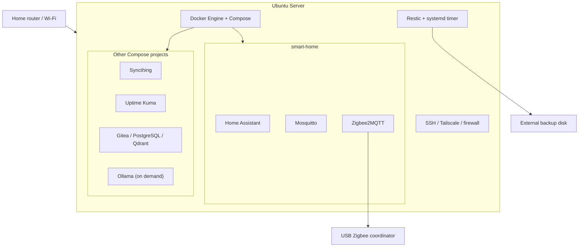

# Architecture

## Host and application boundary

Ubuntu Server runs the hardware and host responsibilities:

- Wi-Fi/network configuration and stable DHCP reservation
- SSH administration
- Tailscale remote access
- Firewall
- Docker Engine and Compose plugin
- Restic backup jobs and systemd timers
- SMART/NVMe health checks

Docker Compose runs application workloads:

| Project        | Services                               | Default state |
| ---            | ---                                    | ---           |
| smart-home     | Home Assistant, Mosquitto, Zigbee2MQTT | Always on     |
| storage        | Syncthing                              | Always on     |
| monitoring     | Uptime Kuma                            | Always on     |
| infrastructure | AdGuard Home                           | Optional      |
| development    | Gitea, PostgreSQL, Qdrant              | On demand     |
| ai             | Ollama                                 | On demand     |

## 8 GB RAM policy

The budgets below are starting limits, not measured consumption. Tune after observing real usage.

| Workload                         | Initial memory ceiling |
| ---                              | ---:                   |
| Host OS, Docker, system services | Reserve 1.5–2 GB       |
| Home Assistant                   | 900 MB                 |
| Zigbee2MQTT                      | 350 MB                 |
| Mosquitto                        | 128 MB                 |
| Syncthing                        | 350 MB                 |
| Uptime Kuma                      | 300 MB                 |
| Gitea                            | 400 MB                 |
| PostgreSQL                       | 500 MB                 |
| Qdrant                           | 500 MB                 |
| Ollama                           | 3 GB, on demand        |

Do not start all optional projects simultaneously. Ollama's model memory and inference context can exceed container expectations. Start with a small quantized model and benchmark.

## Storage

Use `/srv/homelab` for Compose files and persistent application data. Keep the Git checkout separate at `/opt/homelab-ubuntu`.

Suggested layout:

```text
/opt/homelab-ubuntu/          # Git checkout; no runtime data
/srv/homelab/
├── data/
│   ├── homeassistant/
│   ├── zigbee2mqtt/
│   ├── mosquitto/
│   ├── syncthing/
│   ├── uptime-kuma/
│   ├── gitea/
│   ├── postgresql/
│   ├── qdrant/
│   └── ollama/
├── files/
│   ├── documents/
│   ├── photos/
│   └── shared/
└── backups/                  # temporary local staging only
/mnt/homelab-backup/          # separate external disk
```

A 512 GB SSD is sufficient for the OS, containers, application state and moderate files. Photo/video libraries and backups can consume it quickly. Prefer an external disk for bulk data and backups.

## Network

Home Assistant uses host networking for discovery. Mosquitto publishes its listener only on host loopback (`127.0.0.1:1883`) for Home Assistant; Zigbee2MQTT reaches Mosquitto over the Compose network. Zigbee2MQTT frontend is published on port 8081.

All other published ports should be limited to trusted LAN/Tailscale access using firewall policy. Never forward administration ports from the Internet.

## Mermaid diagram


