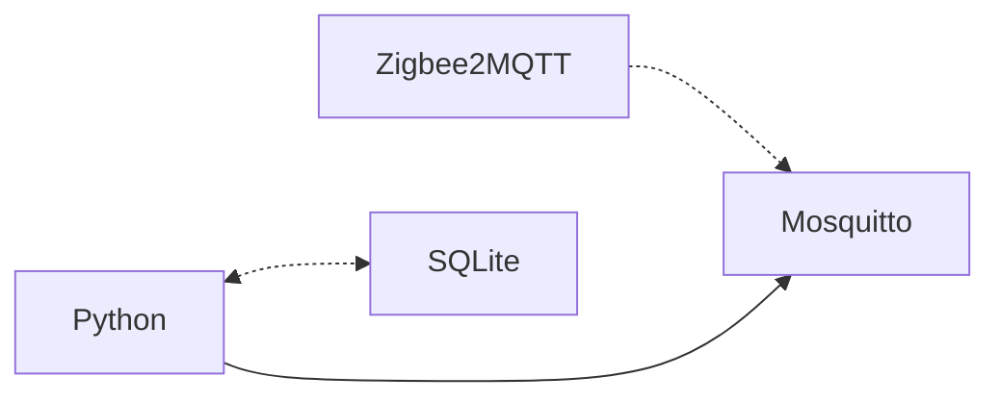

# Zigbee controller

## architecture



## installation 
```sh
sudo apt update

sudo apt install -y \
    mosquitto \
    mosquitto-clients

sudo systemctl enable --now mosquitto
sudo systemctl status mosquitto

sudo apt install docker.io docker-compose-v2
```

## configuration
```sh
cat /etc/mosquitto/mosquitto.conf

ls -la /var/lib/mosquitto/
```
configuration example
```
persistence true
persistence_location /mosquitto/data/
log_dest stdout

listener 1883 0.0.0.0
allow_anonymous false
password_file /mosquitto/config/passwords
```

## check installation 
```sh
## terminal #1
mosquitto_sub -h localhost -t 'test/topic' -v

## terminal #2
mosquitto_pub -h localhost -t 'test/topic' -m 'hello'
```

## prepare files for start
```sh
export ZIGBEE_PORT="$(find /dev/serial/by-id -maxdepth 1 -type l | head -n1)"
echo "$ZIGBEE_PORT"

sudo mkdir -p /opt/zigbee2mqtt/data

sudo chown -R "$USER":"$USER" /opt/zigbee2mqtt

cd /opt/zigbee2mqtt
sudo mkdir -p /opt/zigbee2mqtt/data

## configuration 
cat /opt/zigbee2mqtt/data/configuration.yaml
sudo echo "
version: 5

mqtt:
  base_topic: zigbee2mqtt
  server: mqtt://localhost

serial:
  port: /dev/ttyUSB0
  adapter: zstack

frontend:
  enabled: true
  port: 8081

advanced:
  channel: 11
  network_key: GENERATE
  pan_id: GENERATE
  ext_pan_id: GENERATE

homeassistant:
  enabled: false
" | sudo tee /opt/zigbee2mqtt/data/configuration.yaml > /dev/null

sudo cat /opt/zigbee2mqtt/data/configuration.yaml

##   docker compose 
cd /opt/zigbee2mqtt

echo "
services:
  zigbee2mqtt:
    container_name: zigbee2mqtt
    image: ghcr.io/koenkk/zigbee2mqtt
    restart: unless-stopped
    network_mode: host

    volumes:
      - ./data:/app/data

    devices:
      - $ZIGBEE_PORT:/dev/ttyUSB0
" | tee /opt/zigbee2mqtt/docker-compose.yml > /dev/null

cat /opt/zigbee2mqtt/docker-compose.yml
```

## start docker 
```sh
# Start Docker Compose in detached mode
./zigbee2mqtt-manager.sh start

# Follow container logs (Ctrl+C to exit)
./zigbee2mqtt-manager.sh logs

# Stop and remove Compose containers and networks
./zigbee2mqtt-manager.sh stop

# Restart only zigbee2mqtt
./zigbee2mqtt-manager.sh restart

# check started container 
./zigbee2mqtt-manager.sh status
docker ps 

# start browser with 
./zigbee2mqtt-manager.sh start-browser
```

possible positive response
```
zigbee2mqtt  | [2026-11-17 12:00:43] info:      z2m: Starting zigbee-herdsman (11.2.0)
zigbee2mqtt  | [2026-11-17 12:00:44] info:      zh:adapter:transport: Serial port opened
...
zigbee2mqtt  | [2026-11-17 12:01:02] info:      z2m: Connecting to MQTT server at mqtt://localhost
zigbee2mqtt  | [2026-11-17 12:01:03] info:      z2m: Connected to MQTT server
zigbee2mqtt  | [2026-11-17 12:01:03] info:      z2m:mqtt: MQTT publish: topic 'zigbee2mqtt/bridge/state', payload '{"state":"online"}'
zigbee2mqtt  | [2026-11-17 12:01:03] info:      z2m: Started frontend on port 8081
zigbee2mqtt  | [2026-11-17 12:01:03] info:      z2m: Zigbee2MQTT started!
```

## open console 
```sh
x-www-browser http://localhost:8081
```